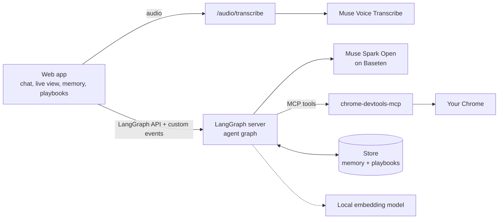

# Chromuse

A browser agent that is **fast**, **remembers**, **learns from experience** and **understands you**. It does tasks in **your own Chrome**, with your tabs and logins, powered by **Muse Spark Open**. Give it a task by typing, speaking, or attaching an image. It opens pages, reads them, clicks and types, and reports back while you watch it live.

**Team:** dev-ansung (solo)
**Models:** Muse Spark Open (open weights, served by Baseten) · Muse Voice Transcribe (Meta Model API)

> Demo video: _link to be added_

## Why Chromuse

**Fast**
- Works in the Chrome you already have open: no browser to launch, no logins to repeat.
- Lists your open tabs before the first model call.
- Sends the model only the latest page snapshot, cutting estimated cost by about half (from logged runs, not a live comparison).
- Keeps screenshots out of the model: they only go to your live view.
- Measured on 39 of my own tasks: median 14.8 s, 90% within 46 s, median 4 model calls (one machine, before the latest token savings).
- _Head-to-head comparison with other browser agents: to be added._

**Remembers**
- Keeps the whole conversation on the server.
- Writes what matters about you to `MEMORY.md`, so the next session starts with it.
- Memory is a plain markdown file you can read, correct and undo.

**Learns from experience**
- Saves the shortest working path as a playbook after a task that took trial and error.
- Records dead ends as pitfalls, so it doesn't repeat them.
- Finds a similar playbook by meaning, with a small local model, and reads the steps only when needed.
- Ranks playbooks that keep failing lower.

**Understands you**
- `SOUL.md` is how it behaves and `MEMORY.md` is what it knows about you.
- You and the agent both edit them.
- If you change a file, the agent is told and doesn't undo your edit.

## Screenshots

| Chat and live view | Memory and playbooks |
|---|---|
| _screenshot: a task in progress, with the live browser view beside the chat_ | _screenshot: the Memory tab (SOUL.md / MEMORY.md) and the Playbooks tab_ |

| Voice, image and audio input | Token usage |
|---|---|
| _screenshot: the composer with the microphone, an attached image and an audio file_ | _screenshot: the usage bar above the chat during a run_ |

## What it does

- **Controls your real browser.** It attaches to the Chrome you already have open (no separate profile or login) through the Chrome DevTools protocol. The open tabs are listed before any model call is made.
- **Works autonomously.** It plans, acts, checks the page after each action and recovers when something fails. Hard limits stop runaway loops.
- **Shows its work.** A live view follows each step with a screenshot, with previous/next/latest arrows and a camera button for an on-demand snapshot.
- **Keeps a soul and a memory.** `SOUL.md` (how it behaves) and `MEMORY.md` (what it knows about you) are plain markdown files that both you and the agent can edit. Every agent change is versioned, announced and undoable.
- **Learns playbooks.** When it solves something by trial and error, it saves the shortest path as a playbook. For a similar task later, it gets a one-line pointer and reads the steps only when it needs them, so they never sit in the context window. Matching runs on a small local embedding model.
- **Takes images, voice and audio files.** Images go to the model directly. Voice and audio are transcribed with Muse Voice Transcribe first, because the model reads text and images only.
- **Is observable.** Every model call, tool call and error goes to a local JSONL log with a report script, and the chat shows token usage per run.
- **Controls its own cost.** Old page snapshots (about three quarters of input tokens in measured runs) are replaced by a short placeholder, so only the latest one is sent.

## How it works



**A run, step by step**

1. **Attach and list tabs.** Before the model is called, the server attaches to Chrome and lists the open tabs. If Chrome can't be reached, the run fails with a hint, and no tokens are spent.
2. **Build the prompt.** Core rules, then `SOUL.md` and `MEMORY.md`, then the open tabs. If the task resembles a saved playbook, one-line pointers are added. If nothing matches, nothing is added.
3. **Loop.** Muse Spark Open picks a tool (open a page, take a snapshot, click, fill, press a key). After each page-changing action, a screenshot is sent to the live view and is never shown to the model.
4. **Control the context.** Only the latest page snapshot is kept in what the model sees. Old tool output is trimmed past a token limit.
5. **Finish.** The agent answers. After a hard run, one extra model call decides whether the run is worth saving as a playbook.

The agent is a LangChain `createAgent` graph with middleware for memory, browser context, playbooks, retries, call limits, tool errors and usage. The middleware modules are small and separately testable, and the instructions are markdown and JSON files, not code.

## Tech stack

| Layer | Used |
|---|---|
| **Model** | Muse Spark Open (`meta-models/muse-spark-open-1026`) on Baseten, OpenAI-compatible chat API. Speech to text: Muse Voice Transcribe over its realtime websocket. Hosted Muse Spark (`muse-spark-1.3`) can be switched on with `AGENT_PROVIDER=meta`. |
| **Agent** | LangChain `createAgent` with middleware, LangGraph, served by `langgraph dev` (Node.js, JavaScript) |
| **Browser control** | `chrome-devtools-mcp` attached to the user's running Chrome, via `@langchain/mcp-adapters` |
| **Web app** | React, TypeScript, Vite, Tailwind CSS, shadcn/ui, assistant-ui (LangGraph runtime) |
| **Memory and playbooks** | LangGraph store (persisted to a local file); retrieval with `@huggingface/transformers` running `all-MiniLM-L6-v2` locally |
| **Audio** | ffmpeg for conversion, browser MediaRecorder for recording |
| **Observability** | Local JSONL telemetry, run report script, optional LangSmith tracing |
| **Tooling** | pnpm, Node.js 22+ |

## Setup

Needs Node.js 22+, pnpm and ffmpeg (ffmpeg only for voice and audio files). Install dependencies with `pnpm install` in `server/` and in `web/`.

### Before you start (once)

Chrome must allow a debugging connection. Pick one (set in `server/config/agent.json` → `browser.attach`):

- **`autoConnect` (default)** — Chrome 144 or newer: open `chrome://inspect/#remote-debugging`, turn on remote debugging, allow the connection if Chrome asks.
- **`browserUrl`** — quit Chrome and start it with `--remote-debugging-port=9222` and a separate `--user-data-dir`; the URL is `browser.browserUrl`.

Keys: copy `.env.example` to `.env` (in this folder or in `server/`) and fill in `BASETEN_API_KEY`. `META_MODEL_API_KEY` is only needed for voice and audio files, or with `AGENT_PROVIDER=meta`. Keep `.env` private; it is ignored by git.

### Run

```bash
cd server && pnpm dev     # LangGraph dev server on http://127.0.0.1:2024 (no hot reload: it would restart the MCP server)
cd web && pnpm dev        # the UI; proxies /api to the server
```

Open the URL Vite prints. On load the page attaches to Chrome and shows your tabs. If it can't, the Browser panel says why and what to do.

## How a run goes

1. **Page load** — the web app runs the `connect` graph (no model): attach, `list_pages`, show the tabs. *Refresh* runs it again.
2. **Each message** — the `agent` graph starts with a `beforeAgent` step that reads the tabs again before the first model call, and the tab list goes into the system prompt. If Chrome can't be attached the run fails there, with zero model calls.
3. **Live view (follows the agent's steps)** — after each page-changing tool call (`navigate_page`, `click`, `fill`, `new_page`, …) the agent sends the UI a screenshot, which the model never sees. It is awaited with a 3 s timeout and never fails the run: a screenshot problem is a warning. The **camera button** takes a screenshot of the selected tab on demand (`GET /live/snapshot`, `server/src/live.js`) and also refreshes the tab list. ‹ › step through the history and `>>` jumps to the latest.

## Soul and memory

Two markdown documents the **agent and you can both edit**: `SOUL.md` (its persona and habits) and `MEMORY.md` (what it keeps about you).

- **In every run** both files are put in the prompt after the core rules and before the open tabs (memory is clipped to a token budget, the soul never is). If you edited a file since the agent last saw it, it is told, once.
- **The agent edits** with `memory_read`, `memory_append` and `memory_edit`. Every change is versioned, diffed and announced: changes to `SOUL.md` appear above the chat, the rest in the Memory panel, each with **Undo** (offered only while it is still the latest version, so it cannot discard a later edit of yours). Secrets are refused and the model is told why.
- **You edit** in the **Memory** tab (SOUL.md, MEMORY.md, notes), with Save, Revert, a version history and Restore. Saves go through the same server-side writer. If the agent changed the file after you opened it, your save is **not applied** and you choose *Keep mine*, *Take theirs* or *Keep editing*; nothing is overwritten silently.
- **Where it lives:** the LangGraph store (saved to a file by `langgraph dev`, so it survives restarts), keyed by `user_id` (default `local`). Starting text: `server/templates/`. Prompt text: `server/prompts/memory.md`. The explanatory notes above each file are interface text, never sent to the model.
- **Off switch / options:** `AGENT_MEMORY=0`, `AGENT_USER_ID`, `AGENT_MEMORY_BUDGET` (tokens, default 1500).

## Playbooks (how it solved tasks before)

Recipes for tasks the agent has done, kept **out of the context window** and found again by meaning with a small local embedding model (`Xenova/all-MiniLM-L6-v2`, runs in-process, no API).

- **Finding:** at the start of a run the task (plus the selected tab's site) is matched against the saved playbooks. A strong match adds up to 3 one-line pointers to the prompt; no match adds nothing. The agent reads the steps with `recall_playbook` and reports with `playbook_feedback` (playbooks that keep failing rank lower).
- **Saving:** the agent calls `save_playbook` when you ask it to remember how to do something. After a run with 8+ tool calls (or 3+ with failures) one extra model call decides whether the run is worth keeping and drafts the shortest path, with dead ends as pitfalls. Switch off with `AGENT_PLAYBOOKS_REFLECT=0`; the whole feature with `AGENT_PLAYBOOKS=0`.
- **Safety:** text that looks like a secret is refused. Steps are by what is visible, never element uids.
- **You:** the **Playbooks** tab lists them with steps, pitfalls and a worked/failed count, and can delete them (editing is not built).
- **Settings:** `playbooks` in `server/config/agent.json` (thresholds, model). Prompts: `server/prompts/playbooks.md`, `reflect.md`.

## Images, voice and audio files

- **Images** (attach button or drag and drop) go to the model as they are: Muse Spark Open reads text and images.
- **Voice** (microphone button): records in the browser; the server converts it with ffmpeg and sends it to **Muse Voice Transcribe** (needs `META_MODEL_API_KEY`, whichever model provider is used). The text lands in the chat box. Failures show under Browser › warnings.
- **Audio files** can be attached; they are transcribed when you send and the model gets the transcript. The model takes no audio itself.
- Route: `POST /audio/transcribe` (raw audio body, up to 2 minutes). Settings: `audio` in `config/agent.json`; `AGENT_AUDIO=0` switches it off.

## Token usage

A bar above the chat shows the tokens used by the current run (in, out, and the size of the last prompt); the tooltip adds reasoning and cached tokens.

## Telemetry (logs you can debug from)

Everything is written to `server/telemetry/` (gitignored: it contains page content):

- `YYYY-MM-DD.jsonl` — one JSON object per line. Every model call (input summary, output text, reasoning, tool calls, token usage, finish reason, latency),
  every tool call (arguments, result, duration), every error (with stack), plus our own events: `connect`, `attach_failed`, `tabs_read`, `screenshot`, `warning`, `live_error`, `live_recovered`, and for memory `memory_read`, `memory_write`, `memory_blocked`, `memory_conflict`, `memory_undo`, `memory_error`.
  Each line carries `run_id` (one per user message), `thread_id`, `span_id` and the graph `node`. The camera logs only when it starts failing or recovers (`live_error`, `live_recovered`).
- `shots/` — every step screenshot the agent took, so a visual state can be checked after the fact.
- `chrome-devtools-mcp.log` — the MCP server's own debug log.

```bash
cd server
node scripts/report.js            # timeline + summary of the latest run (model calls, tool calls, tokens, errors)
node scripts/report.js --list     # recent runs
node scripts/report.js <run_id>   # a specific run
jq -c 'select(.type|test("error|failed"))' telemetry/*.jsonl      # every failure
```

Whole prompts are not logged by default (text is clipped to 4000 chars); set `AGENT_TELEMETRY_FULL=1` to log them in full, `AGENT_TELEMETRY=0` to turn it off.
LangSmith traces are an optional second view: set `LANGSMITH_TRACING=true` and `LANGSMITH_API_KEY`.
Not logged: errors that happen only in the browser page (for example, the server being unreachable); those show in the Problems tab and the browser console.

## Layout

```
server/  config/agent.json   providers, tools, attach mode, thresholds (data)
         prompts/            system.md, tabs.md, memory.md, playbooks.md, reflect.md (data)
         src/graph.js        entry: "agent"    src/connect-graph.js  entry: "connect"
         src/agent.js        createAgent + middleware    src/browser.js  the Chrome attachment
         src/memory.js       soul/memory into the prompt + memory_* tools    src/documents.js  the writer both you and the agent use
         src/documents-run.js  the no-model graph for your reads/saves (langgraph.json: "documents")
         templates/          starting SOUL.md and MEMORY.md
         src/live.js         live view feed              src/live-app.js + app.js  its HTTP routes (langgraph.json http.app)
         src/playbooks.js    playbook store + retrieval  src/playbooks-agent.js  prompt pointers, tools, reflection   src/embeddings.js  local embedding model
         src/transcribe.js   speech to text (Muse Voice Transcribe)   src/audio-app.js  POST /audio/transcribe
         src/tabs.js         list_pages parsing          langgraph.json  graph registry
web/     src/lib/            data layer: parsing, state reducer, store, client, runtime hook (no rendering)
         src/components/     shadcn/ui + assistant-ui elements; agent/ holds the two panels
```

## Tests (no network, no Chrome, no API credits)

```bash
cd server && pnpm test    # real middleware + graphs with a fake model and a fake browser
cd web && pnpm test && pnpm typecheck
```

## Options (env vars)

`AGENT_PROVIDER`, `AGENT_MODEL`, `AGENT_API` (`chat`|`responses`), `AGENT_REASONING` (`low`|`medium`|`high`), `AGENT_MAX_TURNS`, `AGENT_MAX_TOKENS`,
`AGENT_TOOLS`, `AGENT_SCREENSHOTS=0`, `AGENT_BROWSER_ATTACH`, `AGENT_BROWSER_URL`, `AGENT_BROWSER_CHANNEL`, `AGENT_PROMPT_FILE`, `AGENT_CONTEXT_TRIM_TOKENS`.
LangSmith tracing works with `LANGSMITH_TRACING=true` and `LANGSMITH_API_KEY`.

## Not built yet

- Daily notes written automatically after each run, the tidy pass for `MEMORY.md`, per-site notes, and the optional approval switch for the agent's soul edits.
- A rich-text editor for the documents (the Memory tab uses a plain text area).
- Human-in-the-loop pause for CAPTCHA/OTP (LangGraph `interrupt`).
- Loop detection (identical tool call repeated) and flagging of tool failures that come back as plain text.

## Limits

- Built for one person on one machine: a single Chrome and a local store. It isn't a multi-user service.
- The agent takes irreversible actions (sending messages, purchases, deletions) only when the task asks for that exact action, but the checks are prompt rules, not a hard permission system.
- Browser pages are untrusted input. The agent is told to ignore instructions found on web pages, and the playbook-saving step is told to keep only what the run actually did successfully. That too is a prompt rule, not a guarantee.

## Team

**dev-ansung**, solo.

## License

[MIT](LICENSE)
